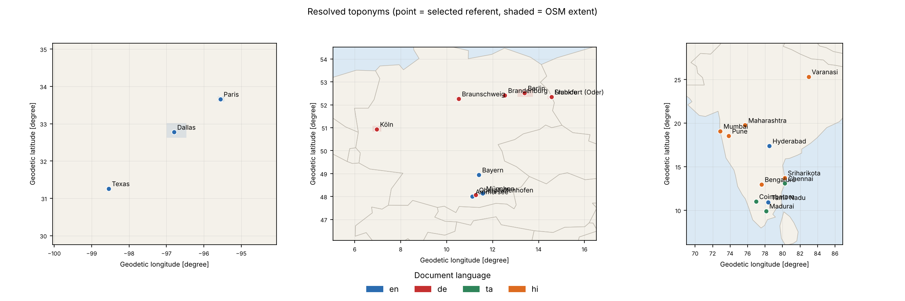

# multilingual-geoparser

Finds place names in English, German, Tamil and Hindi text, figures out which actual place is meant, and puts them on a map (GeoJSON + Folium).

```
$ python main.py parse --offline --ner-backend gazetteer --cache examples/geocode_cache.json \
    --geojson out/oder.geojson \
    --text "Das Hochwasser an der Oder erreichte Frankfurt und Słubice; Brandenburg rief den Katastrophenfall aus."

[cli-0|de] 'Oder'                       → 52.6000, 14.6000  Oder, Germany  (conf 1.00)
[cli-0|de] 'Frankfurt'                  → 52.3471, 14.5506  Frankfurt (Oder), Brandenburg, Germany  (conf 0.85)
[cli-0|de] 'Słubice'                    → 52.3502, 14.5606  Słubice, Lubusz Voivodeship, Poland  (conf 1.00)
[cli-0|de] 'Brandenburg'                → 52.4125, 12.5316  Brandenburg, Germany  (conf 0.78)
```

Frankfurt (Oder), not Frankfurt am Main, because of the rest of the sentence. That kind of case is most of what this project is about.

Rough notes on how I got here, and what's still broken, are in [NOTES.md](NOTES.md).

## pipeline

```
text -> lang id -> NER -> query variants -> Nominatim (+ cache) -> disambiguation -> GeoJSON / map
```

- NER: `Babelscape/wikineural-multilingual-ner` for en/de, `ai4bharat/IndicNER` for hi/ta. spaCy, Stanza and a plain dictionary matcher also work
- query variants: strips Tamil case endings etc. if the plain name finds nothing
- disambiguation: importance, population, place type, name match, "inside a state/country mentioned in the text", distance to the other places. Each result keeps its `score_breakdown`

## setup

```bash
pip install -e ".[ml,dev]"     # without "ml" you only get the offline/gazetteer mode
export GEOPARSER_USER_AGENT="multilingual-geoparser/1.0 (you@example.org)"   # nominatim wants this
```

Python 3.10+. IndicNER might need `huggingface-cli login` first.

## usage

```
$ python main.py parse --offline --ner-backend gazetteer --cache examples/geocode_cache.json \
    --geojson out/ta.geojson --map out/ta.html \
    --text "சென்னையில் பெய்த கனமழையால் மதுரை மற்றும் கோயம்புத்தூர் பகுதிகளில் வெள்ளம் ஏற்பட்டது."

[cli-0|ta] 'சென்னையில்'                 → 13.0827, 80.2707  Chennai, Tamil Nadu, India  (conf 1.00)
[cli-0|ta] 'மதுரை'                      → 9.9252, 78.1198  Madurai, Tamil Nadu, India  (conf 1.00)
[cli-0|ta] 'கோயம்புத்தூர்'              → 11.0168, 76.9558  Coimbatore, Tamil Nadu, India  (conf 1.00)
```

`சென்னையில்` ("in Chennai") only finds Chennai after the suffix gets stripped, see NOTES.

```bash
python main.py parse --input examples/sample_texts.jsonl --geojson out/batch.geojson --map out/batch.html
python main.py evaluate --gold examples/gold_annotations.jsonl --report out/report.json
```

`--help` for the rest (`--ner-backend`, `--country-hint`, `--min-confidence`, `--config`...).

Fully offline (no models, no network, what CI runs):

```bash
python main.py evaluate --gold examples/gold_annotations.jsonl \
    --ner-backend gazetteer --offline --cache examples/geocode_cache.json
```

Heads up: the cache in `examples/` is hand-made in Nominatim's format, not real API output.

## results

Gazetteer baseline, 9 demo docs, 32 place names. Sanity check, not a benchmark.

| lang | gold | P | R | F1 | mean err (km) | median err (km) | acc@161 |
|---|---:|---:|---:|---:|---:|---:|---:|
| all | 32 | 1.000 | 0.969 | 0.984 | 9.0 | 0.1 | 1.000 |
| de | 8 | 1.000 | 1.000 | 1.000 | 0.4 | 0.1 | 1.000 |
| en | 12 | 1.000 | 0.917 | 0.957 | 19.2 | 0.4 | 1.000 |
| hi | 7 | 1.000 | 1.000 | 1.000 | 7.7 | 0.0 | 1.000 |
| ta | 5 | 1.000 | 1.000 | 1.000 | 0.3 | 0.0 | 1.000 |

With the document-context features off (`--config examples/config_no_context.json`), mean error goes 9 km -> 294 km. Paris ends up in France and Frankfurt in am Main.

Haven't run the neural models on a real corpus yet (see todo in NOTES).



Interactive version: [docs/sample_map.html](docs/sample_map.html)

## tests

```bash
pytest
ruff check src tests main.py examples
mypy src
```

## refs

- Gritta et al. 2018, *What's missing in geographical parsing?* (metrics)
- Tedeschi et al. 2021, WikiNEuRal
- Mhaske et al. 2023, Naamapadam / IndicNER
- Leidner 2008, *Toponym Resolution in Text*

Map data © OpenStreetMap contributors. MIT.
